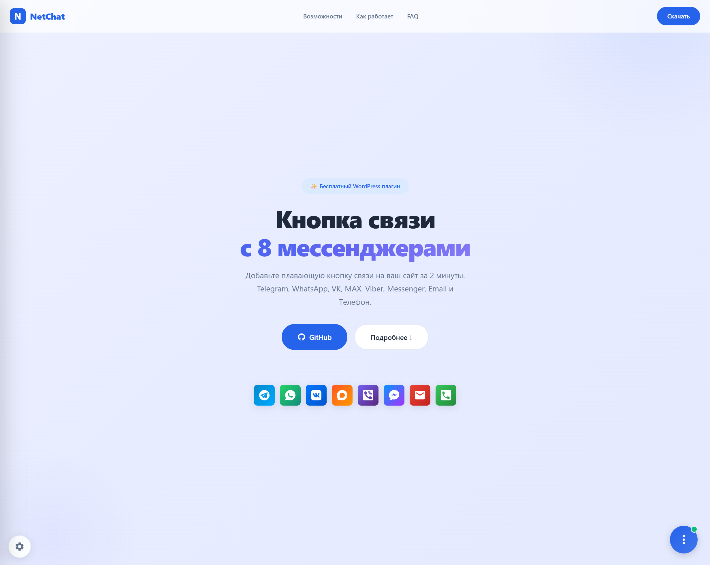
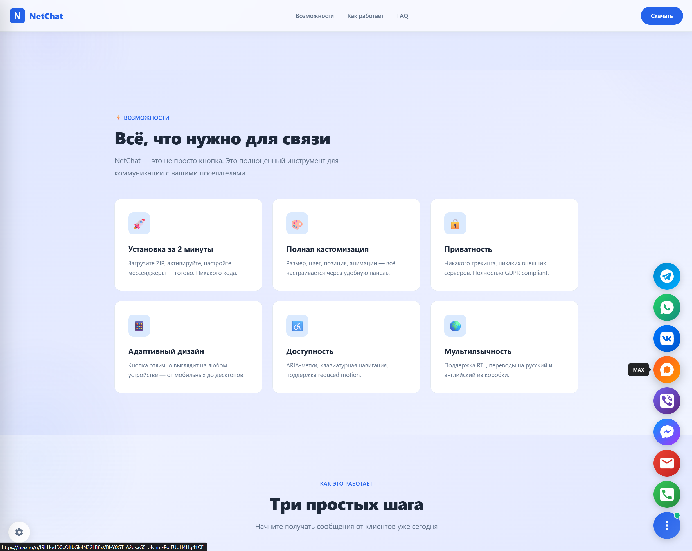

# 🟦 NetChat — Кнопка связи на сайт для WordPress

В NetChat → настройки можно независимо задать появление кнопки и приветствия после 0–100% прокрутки. 0 означает без ожидания, 100 — конец страницы; короткая страница считается просмотренной на 100%. После достижения порога элемент остаётся доступным до перезагрузки. Задержка приветствия начинается, когда достигнуты оба порога и кнопка доступна; закрытое приветствие или открытая форма не показывают его повторно. Внешние CTA и API доступны до порогов. Cookies и постоянный трекинг прокрутки не добавляются.

> Бесплатная кнопка связи на сайт с 8 мессенджерами. Плавающие кнопки для WordPress: Telegram, WhatsApp, VK, MAX, Viber, Messenger, Email, Телефон.
>
> Актуальное промо доступно на https://netchat.vibeservice.ru/

**Версия в разработке:** 1.2.0 | **Лицензия:** GPLv2+ | **Автор:** [omhotey](https://github.com/omhotey)

Кандидат 1.2.0 включает настройки в БД WordPress, контактную форму, две нейтральные встроенные формы, отдельный редактор, заявки, почту и privacy. Настройки и выбранные формы можно [экспортировать и импортировать](docs/DATA_TRANSFER.md) через JSON с preview перед записью. [Обновление](docs/UPGRADE.md), [проверки и ограничения](docs/RELEASE_CHECKLIST.md).

[](https://github.com/omhotey/WP-NetChat/blob/main/LICENSE)
[](https://github.com/omhotey/WP-NetChat/stargazers)
[](https://github.com/omhotey/WP-NetChat/releases)

---

## 🎉 Релиз 1.0

**Дата релиза:** 15 апреля 2026

Первый стабильный релиз плагина NetChat с полной функциональностью:
- 8 мессенджеров: Telegram, WhatsApp, VK, MAX, Viber, Messenger, Email, Телефон
- Полная кастомизация: размер, цвет, позиция, анимации
- Адаптивный дизайн: отдельные настройки для десктопа и мобильных
- В установленном плагине нет встроенного трекера посетителей
- Мультиязычность: русский и английский из коробки

---

## 🖼 Скриншоты и промо

Ниже показаны реальный промо-дизайн, окно настроек и админка плагина. Секция выдержана в стиле промо-страницы `preview/index.html` и демонстрирует актуальный внешний вид интерфейса.

| Промо-страница | Настройки | Админка WordPress | Пример кнопки |
|:--------------:|:---------:|:-----------------:|:-------------:|
|  |  |  |  |

---

## ⚡ Возможности

| Возможность | Описание |
|-------------|----------|
|  **8 мессенджеров** | Telegram, WhatsApp, VK, MAX, Viber, Messenger, Email, Телефон |
| 🎨 **Кастомизация** | Размер, цвет, позиция, анимации — всё настраивается |
| 🚀 **Лёгкий** | Без зависимостей, без внешних библиотек |
| 🔒 **Приватность** | Контакты владельца хранятся на сайте; встроенного трекера нет |
| ♿ **Доступность** | ARIA-метки, клавиатурная навигация, `prefers-reduced-motion` |
| 🌍 **Мультиязычность** | Переводы на русский и английский из коробки |
| 📱 **Адаптивный** | Отдельные настройки для десктопа и мобильных |

---

## 📋 Требования

| Требование | Минимальная версия |
|------------|--------------------|
| WordPress | 5.0+ |
| PHP | 7.2+ |

> После переноса настроек в БД запись в `wp-content` для их сохранения не нужна. Минимальные версии остаются заявленным контрактом; фактически проверенную матрицу смотрите в отчёте этапа A.

---

## 🚀 Установка

### Вариант 1: Через админку WordPress (ZIP)

1. Скачайте опубликованный архив со [страницы релизов](https://github.com/omhotey/WP-NetChat/releases). В проверенном релизе 1.0.0 он называется `WP-NetChat-main.zip`. Для сборки текущего кода: `pwsh -File tools/build-release.ps1`; результат — `dist/release-1.2.0/netchat-wp.zip`. Версия в разработке ещё не опубликована.
2. Перейдите в **Плагины → Добавить новый**
3. Нажмите **Загрузить плагин** → выберите ZIP-файл
4. Нажмите **Установить** → **Активировать**
5. Откройте отдельный пункт **NetChat** главного меню WordPress

### Вариант 2: Через FTP

```bash
# Распакуйте плагин в папку
wp-content/plugins/netchat/

# Активируйте через админку WordPress
```

### Вариант 3: Через WP-CLI

```bash
wp plugin install /path/to/netchat-wp.zip --activate
```

---

## 🔧 Настройка

### Быстрый старт (2 минуты)

1. **Активируйте плагин**
2. Откройте отдельный пункт **NetChat** главного меню WordPress
3. **Включите мессенджеры** переключателем
4. Введите данные (username, номер телефона, email)
5. Нажмите **Сохранить настройки**

Готово! Кнопка появится на сайте автоматически.

### Настройки мессенджеров

| Мессенджер | Что ввести | Пример |
|------------|-----------|--------|
| **Telegram** | Имя пользователя (без `@`) | `durov` |
| **WhatsApp** | Номер с кодом страны (без `+`) | `79001234567` |
| **ВКонтакте** | Имя пользователя | `username` |
| **MAX** | Ссылка на профиль | `https://max.ru/u/f9LH...` |
| **Viber** | Номер с `+` в начале | `+79001234567` |
| **Messenger** | Имя пользователя Facebook | `username` |
| **Email** | Ваш email | `info@example.com` |
| **Телефон** | Номер в любом формате | `+7 (900) 123-45-67` |

### Позиция кнопки

| Параметр | Описание |
|----------|----------|
| **Справа внизу** | Кнопка в правом нижнем углу (по умолчанию) |
| **Слева внизу** | Кнопка в левом нижнем углу |
| **Отступы** | Отступ от краёв в пикселях |

### Внешний вид

| Параметр | Диапазон | По умолчанию |
|----------|----------|--------------|
| **Размер кнопки** | 40–80px | 56px |
| **Цвет кнопки** | Любой HEX | `#2563eb` |
| **Скорость анимации** | 0–1000мс | 300мс |

---

## 📱 Инструкция по подключению мессенджеров

### ✈️ Telegram

**Что ввести:** Имя пользователя без `@`

**Где взять:**
1. Откройте Telegram → **Настройки** → **Изменить профиль**
2. Найдите поле **Имя пользователя**
3. Введите без символа `@`

**Важно:** Username должен быть уникальным и содержать только латинские буквы, цифры и `_`

**Ссылка на сайте:** `https://t.me/username`

---

### 💬 WhatsApp

**Что ввести:** Номер телефона с кодом страны, только цифры

**Правила:**
- ✅ Только цифры
- ✅ Без `+`, пробелов, скобок
- ✅ С кодом страны (`7` для России)

**Пример:** `79001234567` → `https://wa.me/79001234567`

---

### 👥 ВКонтакте

**Что ввести:** Короткое имя профиля

**Где взять:**
1. Откройте вашу страницу VK
2. Посмотрите адресную строку: `vk.com/username`
3. Введите `username`

**Ссылка на сайте:** `https://vk.me/username`

---

### 🔷 MAX

**Что ввести:** Ссылка на профиль

**Где взять:**
1. Откройте приложение MAX → **Профиль**
2. Нажмите **Поделиться** или **QR-код**
3. Скопируйте ссылку

**Пример:** `https://max.ru/u/f9LHodD0cC`

---

### 💜 Viber

**Что ввести:** Номер телефона с `+`

**Правила:**
- ✅ С `+` в начале
- ✅ С кодом страны
- ✅ Без пробелов

**Пример:** `+79001234567`

**Важно:** Ссылка `viber://` работает только если установлено приложение Viber на устройстве пользователя.

---

### 💙 Messenger (Facebook)

**Что ввести:** Имя пользователя Facebook

**Важно:**
- Работает только для **страниц** (Pages), не для личных профилей
- Username настраивается в настройках страницы Facebook

**Где взять:**
1. Откройте вашу страницу Facebook
2. **Настройки страницы** → **Имя пользователя**
3. Введите имя без `@`

**Ссылка на сайте:** `https://m.me/username`

---

### 📧 Email

**Что ввести:** Ваш email адрес

**Пример:** `info@example.com`

При клике откроется почтовый клиент по умолчанию (`mailto:`).

---

### 📞 Телефон

**Что ввести:** Номер телефона в любом формате

**Примеры:**
- `+7 (900) 123-45-67`
- `+79001234567`
- `8 (900) 123-45-67`

На мобильных устройствах при клике откроется набор номера (`tel:`).

---

##  Форматы ссылок (для разработчиков)

| Мессенджер | Схема | Формат |
|------------|-------|--------|
| Telegram | `https` | `https://t.me/{username}` |
| WhatsApp | `https` | `https://wa.me/{phone}` |
| ВКонтакте | `https` | `https://vk.me/{username}` |
| MAX | `https` | `https://max.ru/{path}` |
| Viber | `viber` | `viber://chat?number=%2B{phone}` |
| Messenger | `https` | `https://m.me/{username}` |
| Email | `mailto` | `mailto:{email}` |
| Телефон | `tel` | `tel:{phone}` |

---

## ❓ Частые вопросы

### Это действительно бесплатно?

Да! NetChat полностью бесплатен. Без рекламы, без PRO-версий, без скрытых платежей. Open Source под лицензией GPLv2+.

### Плагин собирает данные?

NetChat хранит настроенные владельцем контакты и приветствие. При включении форм сайт сохраняет обращения, контакты, ответы, снимки схемы и сведения о согласии. Встроенного трекера посетителей нет. Переход по контакту открывает внешний сервис. Промо `preview/` — отдельный сайт; его скрипты не входят в установочный ZIP. Эти свойства не являются гарантией соответствия конкретного сайта всем требованиям законодательства.

### Какие мессенджеры поддерживаются?

8 каналов связи: Telegram, WhatsApp, ВКонтакте, MAX, Viber, Facebook Messenger, Email и Телефон.

### Можно настроить внешний вид?

Да! Размер кнопки, цвет, позиция, скорость анимации — всё настраивается через панель настроек.

### Плагин работает с кэшированием?

Настройки хранятся в БД WordPress. Кеш страниц может отдавать предыдущий HTML виджета: после изменения настроек очистите кеш страниц и CDN. Плагин не управляет кешем сторонних решений.

### Как скрыть кнопку на мобильных/десктопе?

В настройках есть чекбоксы «Десктоп» и «Мобильные». Снимите галочку для нужного устройства.

---

## 🔧 Для разработчиков

### Структура плагина

```
netchat/
├── netchat.php           # Главный файл (инициализация, константы)
├── readme.txt            # WordPress.org readme
├── README.md             # GitHub документация
│
├── includes/
│   ├── admin.php         # Админ-панель WordPress + REST API
│   ├── frontend.php      # Рендеринг виджета на фронтенде
│   ├── storage.php       # Options API, миграция, проверка revision
│   └── helpers.php       # Defaults, валидация, SVG иконки
│
├── assets/
│   ├── css/
│   │   ├── admin.css     # Стили админки
│   │   └── style.css     # Стили фронтенд-виджета
│   ├── js/
│   │   ├── admin.js      # JS админки (REST API сохранение, валидация, управление каналами)
│   │   └── front.js      # JS фронтенд-виджета
│   └── img/              # SVG иконки мессенджеров
│
└── languages/            # Файлы локализации
    ├── ru_RU.mo
    ├── ru_RU.po
    └── netchat.pot
```

### Константы

```php
// В netchat.php
define('NETCHAT_VER', '1.2.0');
define('NETCHAT_DIR', plugin_dir_path(__FILE__));
define('NETCHAT_URL', plugin_dir_url(__FILE__));
define('NETCHAT_FILE', __FILE__);

// Исходный файл предыдущей версии; после миграции не обновляется
define('NETCHAT_DATA', WP_CONTENT_DIR . '/netchat-data.json');
```

### Хранение данных

Настройки хранятся в опции `netchat_settings` через WordPress Options API. Конверт содержит `schema_version`, `revision` и `config`. При обновлении плагин переносит исходный JSON:

```
wp-content/netchat-data.json
```

Существующая новая опция имеет приоритет. Повреждённый или нечитаемый JSON не заменяется defaults. При отсутствии JSON проверяется старая опция `netchat_config`. Исходник сохраняется для восстановления; после проверки переноса архивируйте его вне публичного каталога. Повторная активация не сбрасывает настройки; выключение канала сохраняет контакт. Удаление плагина сохраняет данные по умолчанию; для явной очистки установите `define('NETCHAT_DELETE_DATA', true);` в `wp-config.php` перед удалением.

Чтение использует опцию WordPress. Первоначальное создание и проверка revision используют атомарный SQL через `$wpdb`: стандартный `add_option()` содержит upsert и сам по себе не защищает от перезаписи при конкурентном импорте.

Функции для работы с данными:
- `netchat_get_config()` — чтение из БД
- `netchat_save_config($config, $expected_revision)` — сохранение с проверкой revision
- `netchat_clear_cache()` — очистка только кеша чтения

Обновление и откат требуют сохранения текущих настроек, опции сервисных форм и SQL-таблиц заявок со снимками. Экспорт одного JSON не сохраняет эти данные. Не заменяйте новую БД старым снимком и не возвращайтесь автоматически к 1.0.0: она не читает новые заявки. Используйте [порядок обновления и отката](docs/UPGRADE.md), сохраняя фактический basename и новые записи; очистку NETCHAT_DELETE_DATA при обновлении/откате не включайте.

### REST API

### Контактная форма и сервисные формы 1.2.0

В настройках NetChat включите «Принимать заявки», выберите поля и получателей писем. После обновления форма выключена. Заявки находятся в **NetChat → Заявки**: поиск, статусы, карточка, удаление и повтор уведомления. Заявка сначала сохраняется в БД, поэтому сбой почты не теряет обращение. Статус «Передано почтовому механизму» не подтверждает доставку; SMTP настраивается средствами сайта. WP-Cron выполняет очередь и очистку по срокам хранения; для сайта без посещений нужен обычный запуск WP-Cron по расписанию.

Внешняя кнопка работает при скрытой плавающей кнопке:

```text
[netchat_button text="Обсудить задачу" context="TEST_A"]
[netchat_form text="Оставить заявку" context="TEST_F"]
```

Оба shortcode открывают одну модальную форму. Своя динамическая кнопка: `data-netchat-open="form" data-netchat-context="TEST_F"`. JS после загрузки скрипта: `await NetChat.ready; NetChat.openForm({form:'contact',context:'TEST_F'})`. Старые методы управляют меню каналов; `close()` закрывает и форму.

Данные хранятся в таблицах с префиксом сайта: `netchat_leads`, `netchat_lead_keys` (идентификаторы удалённых запросов на семь дней), `netchat_lead_limits` (ограниченные счётчики). Версия настроек — schema 2; схема таблиц имеет отдельную опцию `netchat_leads_schema`. URL сохраняется без query и fragment, referrer — только origin, UTM — по allowlist. IP и полный User-Agent в заявку не записываются. Для обычной contact-формы письмо содержит защищённую ссылку; текст сообщения включается отдельной настройкой. Для сервисных форм уведомление содержит контакты, все сохранённые ответы с подписями снимка, источник и ссылку независимо от include_message. Privacy export/erase WordPress ищет по email, обращения только с телефоном или Telegram требуют ручного поиска с подтверждением личности. Удаление не удаляет уже отправленную почту и независимые резервные копии.

Публичные маршруты: `GET /wp-json/netchat/v1/leads/token` и `POST /wp-json/netchat/v1/leads`. POST принимает плоские поля формы, `request_key`, подписанный токен и контекст; возвращает подтверждение без ID/карточки. Один ключ и одинаковый запрос создают одну заявку. Изменённое содержимое с прежним ключом даёт 409, удалённый ключ — 410 в течение семи дней. Токен действует 20 минут и запрашивается заново перед отправкой. Скрытие кнопки не запрещает приём заявок; выключение формы запрещает POST даже со старой страницы.

Лимиты: пять новых заявок за десять минут на сетевой адрес, 500 для сайта; выдача токенов — 30/2000. Адрес участвует только в HMAC с меняющимся окном и в распределении по ограниченным SQL-слотам. Общий NAT и совпадение слотов могут приводить к 429. Это базовая защита, для сайтов с большим потоком требуется настройка защиты на сервере. Минимальные версии и совместимость с внешним page cache ещё требуют отдельной проверки.

Хуки: `netchat_lead_data` получает нормализованные поля до повторной проверки; `netchat_lead_created($id)` вызывается только после нового insert, `netchat_lead_status_changed($id,$new,$old)` — после фактического изменения. Повтор POST не повторяет hooks. Административные действия используют `manage_options`, POST и nonce; публичного чтения заявок нет. Перед откатом схемы восстановите согласованную резервную копию БД; экспорт настроек не содержит заявки.

### API настроек

```
POST /wp-json/netchat/v1/settings
```

Требуются `manage_options` и REST nonce. POST принимает полный документ настроек и `revision`. Ошибочные значения возвращают 400, устаревшая форма — 409. При конфликте сохраните свой ввод отдельно и обновите страницу. Сторонние REST-клиенты также должны передавать revision.

### WordPress хуки

| Хук | Назначение |
|-----|-----------|
| `plugins_loaded` | Загрузка текстового домена |
| `admin_menu` | Страница настроек |
| `admin_enqueue_scripts` | CSS/JS админки |
| `wp_enqueue_scripts` | CSS/JS фронтенда |
| `wp_footer` | Вывод виджета |
| `rest_api_init` | REST API endpoint |

> **Примечание:** В версии 1.0.0 плагин НЕ добавляет собственных action-хуков и filter-хуков для расширения. Если вам нужна кастомизация — изучите исходный код или форкните репозиторий.

### Валидация ссылок

```php
// helpers.php — автоматически формирует правильные ссылки
function netchat_validate_url($raw, $type): string;
// telegram  → https://t.me/username
// whatsapp  → https://wa.me/79001234567
// vk        → https://vk.me/username
// viber     → viber://chat?number=%2B79001234567
// email     → mailto:info@example.com
// phone     → tel:+79001234567
```

---

## 🗺️ Планы развития

> Кандидат 1.2.0 описан в [CHANGELOG](CHANGELOG.md); порядок обновления и границы проверки — в [UPGRADE](docs/UPGRADE.md) и [RELEASE_CHECKLIST](docs/RELEASE_CHECKLIST.md). Таблица ниже содержит исторические идеи и не является текущим релизным планом.

| Функция | Версия | Приоритет | Описание |
|---------|--------|-----------|----------|
| Шорткод `[netchat]` | 1.1.0 | 🟡 Средний | Ручная вставка виджета в контент страниц |
| Gutenberg блок | 1.1.0 | 🟡 Средний | Блок для редактора WordPress с превью |
| Action-хуки | 1.2.0 | 🟡 Средний | `netchat_loaded`, `netchat_settings_saved` для интеграции |
| Filter-хуки | 1.2.0 | 🟡 Средний | `netchat_config`, `netchat_messengers` для кастомизации |
| Встроенный чат | 1.3.0 | 🟠 Высокий | Окно чата прямо на сайте (без перехода в мессенджер) |
| Чатботы и ИИ-агенты | 1.4.0 | 🟠 Высокий | Подключение AI-ассистентов для автоответов |
| Метрики и аналитика | 1.4.0 | 🟡 Средний | Статистика кликов, конверсий, популярных каналов |
| Интеграция с CRM | 1.5.0 | 🟡 Средний | Передача заявок в Bitrix24, AmoCRM и др. |
| Мультисайт | 2.0.0 | 🔵 Низкий | Поддержка WordPress Multisite |
| Unit-тесты | 2.0.0 | 🔵 Низкий | PHPUnit для валидации и хранения данных |

---

## 🎨 Превью

Откройте файл `preview/index.html` в браузере для интерактивного превью плагина с живыми настройками.

---

## 📝 О плагине

**NetChat** — это бесплатный WordPress плагин для добавления плавающих кнопок мессенджеров на сайт. Кнопка связи на сайт устанавливается за 2 минуты без написания кода.

Плагин добавляет на сайт кнопку, при нажатии на которую открывается меню с кнопками Telegram, WhatsApp, ВКонтакте, MAX, Viber, Facebook Messenger, Email и Телефон. Все кнопки на сайт настраиваются: размер, цвет, позиция, анимация появления.

Кнопка связи на сайт бесплатно, без регистрации, без PRO-версий и скрытых платежей. Open Source под лицензией GPLv2+.

### Ключевые слова
кнопка на сайт, кнопка связи на сайт, плавающие кнопки на сайт, кнопки мессенджеров на сайт, кнопка telegram на сайт, кнопка whatsapp на сайт, кнопка вк на сайт, кнопка на сайт wordpress, всплывающая кнопка на сайт, кнопка на сайт бесплатно, виджет кнопки на сайт, кнопки социальных сетей на сайт, установить кнопку на сайт, добавить кнопку на сайт.

---

## 🤝 Поддержка проекта

Этот проект создан бесплатно и с любовью. Если он помог вам — вы можете поддержать автора:

[Поддержать проект](https://yoomoney.ru/to/410011968447166)

Любая сумма идёт на развитие плагина. Спасибо каждому! 🙏

---

## 📄 Лицензия

GPLv2 or later — [Подробнее](https://www.gnu.org/licenses/gpl-2.0.html)

---

## 👨‍ Автор

[**omhotey**](https://github.com/omhotey) — разработчик WordPress плагинов

| Ссылка | Значение |
|--------|----------|
| GitHub | [github.com/omhotey](https://github.com/omhotey) |
| Telegram | [@omhotey](https://t.me/omhotey) |

---

**Последнее обновление:** 13 октября 2026 | **Версия в разработке:** 1.2.0

## Кандидат релиза 1.2.0

Две нейтральные встроенные формы, отдельный редактор и жизненный цикл форм, единственная основная форма, привязки страниц и два режима кнопки. Экспорт/импорт настроек и своих форм: [DATA_TRANSFER](docs/DATA_TRANSFER.md). Обновление: [UPGRADE](docs/UPGRADE.md), изменения: [CHANGELOG](CHANGELOG.md), проверки: [RELEASE_CHECKLIST](docs/RELEASE_CHECKLIST.md). Минимумы PHP 7.2 / WordPress 5.0 сохранены; hosted-матрица и браузер новой ревизии ещё не выполнены.
