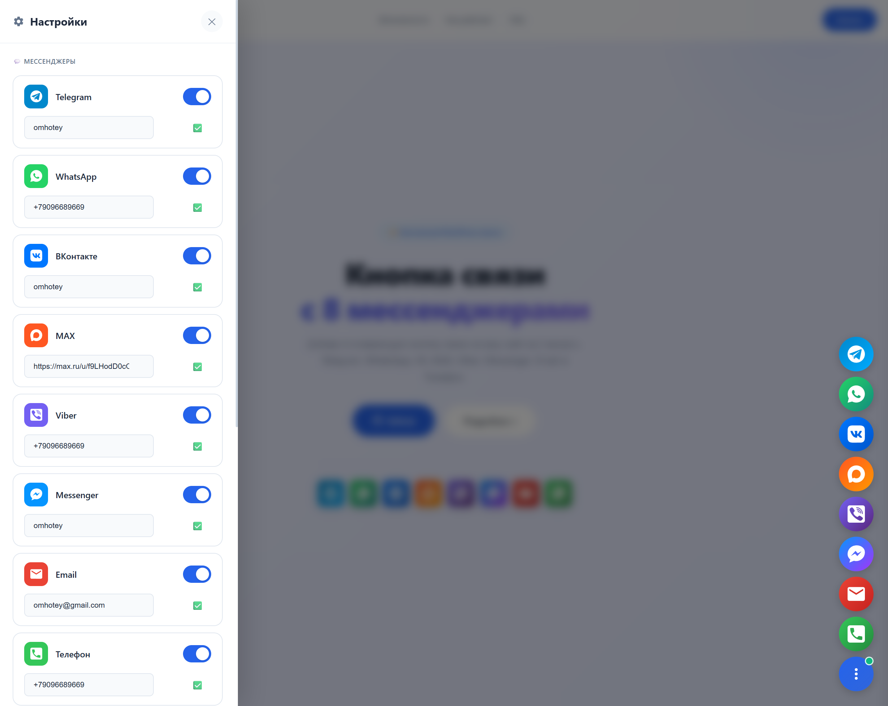
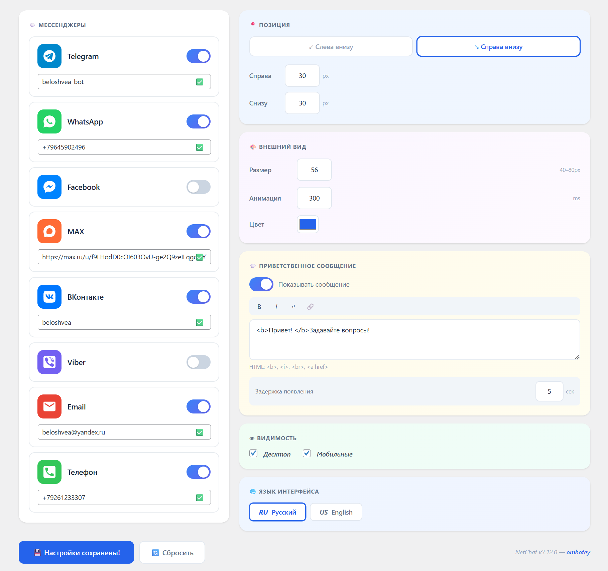

# 🟦 NetChat — Кнопка связи на сайт для WordPress

> Бесплатная кнопка связи на сайт с 8 мессенджерами. Плавающие кнопки для WordPress: Telegram, WhatsApp, VK, MAX, Viber, Messenger, Email, Телефон.

**Версия:** 1.0.0 | **Лицензия:** GPLv2+ | **Автор:** [omhotey](https://github.com/omhotey)

[](https://github.com/omhotey/WP-NetChat/blob/main/LICENSE)
[](https://github.com/omhotey/WP-NetChat/stargazers)
[](https://github.com/omhotey/WP-NetChat/releases)

---

## 🎉 Релиз 1.0

**Дата релиза:** 15 апреля 2026

Первый стабильный релиз плагина NetChat с полной функциональностью:
- 8 мессенджеров: Telegram, WhatsApp, VK, MAX, Viber, Messenger, Email, Телефон
- Полная кастомизация: размер, цвет, позиция, анимации
- Адаптивный дизайн: отдельные настройки для десктопа и мобильных
- GDPR compliant: никакого трекинга, без внешних серверов
- Мультиязычность: русский и английский из коробки

---

## � Скриншоты

Ниже показаны реальный промо-дизайн и панель управления плагином. Секция выдержана в стиле промо-страницы `preview/index.html` и демонстрирует актуальный внешний вид интерфейса.

| Промо-страница | Настройки | Админка WordPress | Пример кнопки |
|:--------------:|:---------:|:-----------------:|:-------------:|
|  |  |  |  |

---

## ⚡ Возможности

| Возможность | Описание |
|-------------|----------|
|  **8 мессенджеров** | Telegram, WhatsApp, VK, MAX, Viber, Messenger, Email, Телефон |
| 🎨 **Кастомизация** | Размер, цвет, позиция, анимации — всё настраивается |
| 🚀 **Лёгкий** | Без зависимостей, без внешних библиотек |
| 🔒 **Приватность** | Никакого трекинга, без внешних серверов, GDPR compliant |
| ♿ **Доступность** | ARIA-метки, клавиатурная навигация, `prefers-reduced-motion` |
| 🌍 **Мультиязычность** | Переводы на русский и английский из коробки |
| 📱 **Адаптивный** | Отдельные настройки для десктопа и мобильных |

---

## 📋 Требования

| Требование | Минимальная версия |
|------------|--------------------|
| WordPress | 5.0+ |
| PHP | 7.2+ |

> Для сохранения настроек должна быть доступна запись в папку `wp-content`.

---

## 🚀 Установка

### Вариант 1: Через админку WordPress (ZIP)

1. Скачайте архив: [netchat-wp.zip](https://github.com/omhotey/WP-NetChat/releases)
2. Перейдите в **Плагины → Добавить новый**
3. Нажмите **Загрузить плагин** → выберите ZIP-файл
4. Нажмите **Установить** → **Активировать**
5. Перейдите в **Настройки → NetChat** для настройки

### Вариант 2: Через FTP

```bash
# Распакуйте плагин в папку
wp-content/plugins/netchat/

# Активируйте через админку WordPress
```

### Вариант 3: Через WP-CLI

```bash
wp plugin install --activate https://github.com/omhotey/WP-NetChat/releases/latest/download/netchat-wp.zip
```

---

## 🔧 Настройка

### Быстрый старт (2 минуты)

1. **Активируйте плагин**
2. Перейдите в **Настройки → NetChat**
3. **Включите мессенджеры** переключателем
4. Введите данные (username, номер телефона, email)
5. Нажмите **Сохранить настройки**

Готово! Кнопка появится на сайте автоматически.

### Настройки мессенджеров

| Мессенджер | Что ввести | Пример |
|------------|-----------|--------|
| **Telegram** | Имя пользователя (без `@`) | `durov` |
| **WhatsApp** | Номер с кодом страны (без `+`) | `79001234567` |
| **ВКонтакте** | Имя пользователя | `username` |
| **MAX** | Ссылка на профиль | `https://max.ru/u/f9LH...` |
| **Viber** | Номер с `+` в начале | `+79001234567` |
| **Messenger** | Имя пользователя Facebook | `username` |
| **Email** | Ваш email | `info@example.com` |
| **Телефон** | Номер в любом формате | `+7 (900) 123-45-67` |

### Позиция кнопки

| Параметр | Описание |
|----------|----------|
| **Справа внизу** | Кнопка в правом нижнем углу (по умолчанию) |
| **Слева внизу** | Кнопка в левом нижнем углу |
| **Отступы** | Отступ от краёв в пикселях |

### Внешний вид

| Параметр | Диапазон | По умолчанию |
|----------|----------|--------------|
| **Размер кнопки** | 40–80px | 56px |
| **Цвет кнопки** | Любой HEX | `#2563eb` |
| **Скорость анимации** | 0–1000мс | 300мс |

---

## 📱 Инструкция по подключению мессенджеров

### ✈️ Telegram

**Что ввести:** Имя пользователя без `@`

**Где взять:**
1. Откройте Telegram → **Настройки** → **Изменить профиль**
2. Найдите поле **Имя пользователя**
3. Введите без символа `@`

**Важно:** Username должен быть уникальным и содержать только латинские буквы, цифры и `_`

**Ссылка на сайте:** `https://t.me/username`

---

### 💬 WhatsApp

**Что ввести:** Номер телефона с кодом страны, только цифры

**Правила:**
- ✅ Только цифры
- ✅ Без `+`, пробелов, скобок
- ✅ С кодом страны (`7` для России)

**Пример:** `79001234567` → `https://wa.me/79001234567`

---

### 👥 ВКонтакте

**Что ввести:** Короткое имя профиля

**Где взять:**
1. Откройте вашу страницу VK
2. Посмотрите адресную строку: `vk.com/username`
3. Введите `username`

**Ссылка на сайте:** `https://vk.me/username`

---

### 🔷 MAX

**Что ввести:** Ссылка на профиль

**Где взять:**
1. Откройте приложение MAX → **Профиль**
2. Нажмите **Поделиться** или **QR-код**
3. Скопируйте ссылку

**Пример:** `https://max.ru/u/f9LHodD0cC`

---

### 💜 Viber

**Что ввести:** Номер телефона с `+`

**Правила:**
- ✅ С `+` в начале
- ✅ С кодом страны
- ✅ Без пробелов

**Пример:** `+79001234567`

**Важно:** Ссылка `viber://` работает только если установлено приложение Viber на устройстве пользователя.

---

### 💙 Messenger (Facebook)

**Что ввести:** Имя пользователя Facebook

**Важно:**
- Работает только для **страниц** (Pages), не для личных профилей
- Username настраивается в настройках страницы Facebook

**Где взять:**
1. Откройте вашу страницу Facebook
2. **Настройки страницы** → **Имя пользователя**
3. Введите имя без `@`

**Ссылка на сайте:** `https://m.me/username`

---

### 📧 Email

**Что ввести:** Ваш email адрес

**Пример:** `info@example.com`

При клике откроется почтовый клиент по умолчанию (`mailto:`).

---

### 📞 Телефон

**Что ввести:** Номер телефона в любом формате

**Примеры:**
- `+7 (900) 123-45-67`
- `+79001234567`
- `8 (900) 123-45-67`

На мобильных устройствах при клике откроется набор номера (`tel:`).

---

##  Форматы ссылок (для разработчиков)

| Мессенджер | Схема | Формат |
|------------|-------|--------|
| Telegram | `https` | `https://t.me/{username}` |
| WhatsApp | `https` | `https://wa.me/{phone}` |
| ВКонтакте | `https` | `https://vk.me/{username}` |
| MAX | `https` | `https://max.ru/{path}` |
| Viber | `viber` | `viber://chat?number=%2B{phone}` |
| Messenger | `https` | `https://m.me/{username}` |
| Email | `mailto` | `mailto:{email}` |
| Телефон | `tel` | `tel:{phone}` |

---

## ❓ Частые вопросы

### Это действительно бесплатно?

Да! NetChat полностью бесплатен. Без рекламы, без PRO-версий, без скрытых платежей. Open Source под лицензией GPLv2+.

### Плагин собирает данные?

Нет. NetChat не собирает, не хранит и не передаёт никакие персональные данные. Полностью GDPR compliant.

### Какие мессенджеры поддерживаются?

8 каналов связи: Telegram, WhatsApp, ВКонтакте, MAX, Viber, Facebook Messenger, Email и Телефон.

### Можно настроить внешний вид?

Да! Размер кнопки, цвет, позиция, скорость анимации — всё настраивается через панель настроек.

### Плагин работает с кэшированием?

Да. Плагин хранит настройки в JSON-файле (`wp-content/netchat-data.json`), минуя базу данных WordPress, что обеспечивает быструю работу и совместимость с плагинами кэширования.

### Как скрыть кнопку на мобильных/десктопе?

В настройках есть чекбоксы «Десктоп» и «Мобильные». Снимите галочку для нужного устройства.

---

## 🔧 Для разработчиков

### Структура плагина

```
netchat/
├── netchat.php           # Главный файл (инициализация, константы)
├── readme.txt            # WordPress.org readme
├── README.md             # GitHub документация
│
├── includes/
│   ├── admin.php         # Админ-панель WordPress + REST API
│   ├── frontend.php      # Рендеринг виджета на фронтенде
│   └── helpers.php       # Хранение данных (JSON), валидация, SVG иконки
│
├── assets/
│   ├── css/
│   │   ├── admin.css     # Стили админки
│   │   └── style.css     # Стили фронтенд-виджета
│   ├── js/
│   │   ├── admin.js      # JS админки (Sortable, REST API сохранение)
│   │   └── front.js      # JS фронтенд-виджета
│   └── img/              # SVG иконки мессенджеров
│
└── languages/            # Файлы локализации
    ├── ru_RU.mo
    ├── ru_RU.po
    └── netchat.pot
```

### Константы

```php
// В netchat.php
define('NETCHAT_VER', '1.0.0');
define('NETCHAT_DIR', plugin_dir_path(__FILE__));
define('NETCHAT_URL', plugin_dir_url(__FILE__));
define('NETCHAT_FILE', __FILE__);

// В helpers.php — файл хранения данных (НЕ база данных WP)
define('NETCHAT_DATA', WP_CONTENT_DIR . '/netchat-data.json');
```

### Хранение данных

Плагин **не использует** базу данных WordPress. Все настройки хранятся в JSON-файле:

```
wp-content/netchat-data.json
```

Функции для работы с данными:
- `netchat_get_config()` — чтение из JSON-файла
- `netchat_save_config($config)` — запись в JSON-файл
- `netchat_delete_config()` — удаление файла (сброс)

### REST API

```
POST /wp-json/netchat/v1/settings
```

Сохранение настроек через REST API. Требуется авторизация с правом `manage_options`.

### WordPress хуки

| Хук | Назначение |
|-----|-----------|
| `plugins_loaded` | Загрузка текстового домена |
| `admin_menu` | Страница настроек |
| `admin_enqueue_scripts` | CSS/JS админки |
| `wp_enqueue_scripts` | CSS/JS фронтенда |
| `wp_footer` | Вывод виджета |
| `rest_api_init` | REST API endpoint |

> **Примечание:** В версии 1.0.0 плагин НЕ добавляет собственных action-хуков и filter-хуков для расширения. Если вам нужна кастомизация — изучите исходный код или форкните репозиторий.

### Валидация ссылок

```php
// helpers.php — автоматически формирует правильные ссылки
function netchat_validate_url($raw, $type): string;
// telegram  → https://t.me/username
// whatsapp  → https://wa.me/79001234567
// vk        → https://vk.me/username
// viber     → viber://chat?number=%2B79001234567
// email     → mailto:info@example.com
// phone     → tel:+79001234567
```

---

## 🗺️ Планы развития

> Это roadmap — функции, которые **могут** появиться в будущих версиях. Ничего из этого ещё не реализовано.

| Функция | Версия | Приоритет | Описание |
|---------|--------|-----------|----------|
| Шорткод `[netchat]` | 1.1.0 | 🟡 Средний | Ручная вставка виджета в контент страниц |
| Gutenberg блок | 1.1.0 | 🟡 Средний | Блок для редактора WordPress с превью |
| Action-хуки | 1.2.0 | 🟡 Средний | `netchat_loaded`, `netchat_settings_saved` для интеграции |
| Filter-хуки | 1.2.0 | 🟡 Средний | `netchat_config`, `netchat_messengers` для кастомизации |
| Встроенный чат | 1.3.0 | 🟠 Высокий | Окно чата прямо на сайте (без перехода в мессенджер) |
| Чатботы и ИИ-агенты | 1.4.0 | 🟠 Высокий | Подключение AI-ассистентов для автоответов |
| Метрики и аналитика | 1.4.0 | 🟡 Средний | Статистика кликов, конверсий, популярных каналов |
| Интеграция с CRM | 1.5.0 | 🟡 Средний | Передача заявок в Bitrix24, AmoCRM и др. |
| Мультисайт | 2.0.0 | 🔵 Низкий | Поддержка WordPress Multisite |
| Unit-тесты | 2.0.0 | 🔵 Низкий | PHPUnit для валидации и хранения данных |

---

## 🎨 Превью

Откройте файл `preview/index.html` в браузере для интерактивного превью плагина с живыми настройками.

---

## 📝 О плагине

**NetChat** — это бесплатный WordPress плагин для добавления плавающих кнопок мессенджеров на сайт. Кнопка связи на сайт устанавливается за 2 минуты без написания кода.

Плагин добавляет на сайт кнопку, при нажатии на которую открывается меню с кнопками Telegram, WhatsApp, ВКонтакте, MAX, Viber, Facebook Messenger, Email и Телефон. Все кнопки на сайт настраиваются: размер, цвет, позиция, анимация появления.

Кнопка связи на сайт бесплатно, без регистрации, без PRO-версий и скрытых платежей. Open Source под лицензией GPLv2+.

### Ключевые слова
кнопка на сайт, кнопка связи на сайт, плавающие кнопки на сайт, кнопки мессенджеров на сайт, кнопка telegram на сайт, кнопка whatsapp на сайт, кнопка вк на сайт, кнопка на сайт wordpress, всплывающая кнопка на сайт, кнопка на сайт бесплатно, виджет кнопки на сайт, кнопки социальных сетей на сайт, установить кнопку на сайт, добавить кнопку на сайт.

---

## 🤝 Поддержка проекта

Этот проект создан бесплатно и с любовью. Если он помог вам — вы можете поддержать автора:

[Поддержать проект](https://yoomoney.ru/to/410011968447166)

Любая сумма идёт на развитие плагина. Спасибо каждому! 🙏

---

## 📄 Лицензия

GPLv2 or later — [Подробнее](https://www.gnu.org/licenses/gpl-2.0.html)

---

## 👨‍ Автор

[**omhotey**](https://github.com/omhotey) — разработчик WordPress плагинов

| Ссылка | Значение |
|--------|----------|
| GitHub | [github.com/omhotey](https://github.com/omhotey) |
| Telegram | [@omhotey](https://t.me/omhotey) |

---

**Последнее обновление:** 15 апреля 2026 | **Версия:** 1.0.0 (Stable Release)
